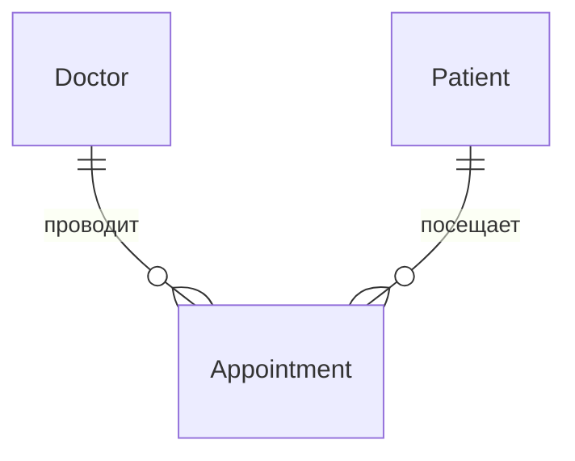

# Ветклиника доктора Котова

Демонстрация рабочего дня клиники. Клиент записывает питомца, врач видит своё расписание, заполняет результат визита и формирует PDF. Проект использует Python 3.11, Django 5.2.19, PostgreSQL 15 и WeasyPrint 68.0.

## Локальный запуск

1. Установите Docker с Compose. Для новой установки скопируйте `.env.example` в `.env` (PowerShell: `Copy-Item .env.example .env`). Если `.env` уже есть, сохраните его настройки и проверьте `WEB_PORT`.
2. Укажите разные случайные значения для `SECRET_KEY` и `DB_PASSWORD`. Например, дважды выполните `python -c "import secrets; print(secrets.token_urlsafe(48))"`. Все остальные значения для демо уже указаны в примере. Telegram необязателен.
3. Выполните команды из каталога репозитория:

```sh
docker compose build web
docker compose up -d db
docker compose run --rm web python manage.py migrate
docker compose run --rm web python manage.py seed_demo
docker compose run --rm web python manage.py createsuperuser
docker compose up -d web
docker compose port web 8000
```

Последняя команда выводит фактический адрес на компьютере. По умолчанию доступны [запись клиента](http://127.0.0.1:8000/), [кабинет](http://127.0.0.1:8000/doctor/) и [управление аккаунтами](http://127.0.0.1:8000/admin/). Если порт занят, задайте свободный `WEB_PORT` в `.env`, повторите `docker compose up -d web` и подставьте новый порт в адреса. Порт приложения внутри контейнера всегда 8000.

`seed_demo` создаёт визиты на сегодня и завтра по текущему времени компьютера в зоне `CLINIC_TIME_ZONE` (по умолчанию `Europe/Moscow`). Если ваш компьютер работает в другой зоне и расписание должно совпадать с его местной датой, задайте в `.env` соответствующую зону IANA, например `Asia/Yekaterinburg`. Даты рассчитываются в момент загрузки. Команда откажется работать, если в базе уже есть врачи, пациенты или визиты. Для остановки с сохранением данных выполните `docker compose down`.

## Аккаунты и демонстрация

1. Откройте `/admin/` и войдите под суперпользователем из шага `createsuperuser`.
2. Создайте обычный аккаунт для врача. В разделе «Врачи» откройте карточку демонстрационного врача, выберите этот аккаунт в поле `User` и оставьте отметку «Принимает пациентов» включённой. Сохраните карточку.
3. Откройте `/login/` в приватном окне и войдите под аккаунтом врача. После входа откроется его расписание.

Для отдельного аккаунта администратора клиники назначьте группу «Администраторы клиники» с разрешением `clinic.manage_clinic`. Если пароль принят, но кабинет показывает 403, проверьте привязку к активному врачу или членство в этой группе. Отметка «Статус персонала» сама по себе кабинет не открывает. Доступ к Django admin выдаётся отдельно.

| Пользователь | Возможности |
|---|---|
| Гость | Создать запись на свободное время |
| Врач | Смотреть собственные визиты, искать своих пациентов, завершать свой приём, получать выписку по своим визитам |
| Администратор клиники | Общее расписание, все карты, изменение контактов, добавление врача |
| Аккаунт без активного профиля или разрешения управления | Вход в клинические данные закрыт |

## Сценарий показа на 3 минуты

Понадобятся чистая демонстрационная база после `seed_demo` и аккаунт, привязанный к **Доктору Ливси** по инструкции выше. Откройте главную страницу в отдельном окне без входа.

1. Запишите вымышленного питомца **Марс** к Доктору Ливси **на завтра в 10:30**. После отправки форма покажет «Вы успешно записаны!».
2. Заполните форму ещё раз с другим вымышленным питомцем, выбрав того же врача, дату и время. Форма сообщит «На это время врач уже занят».
3. Войдите под аккаунтом Доктора Ливси. В расписании выберите **Завтра**, найдите Марса и нажмите **Осмотр**. Введите диагноз и назначения, выберите **Завершено** и нажмите **Сохранить результаты**.
4. Нажмите на имя питомца в расписании. Сверьте диагноз и назначения в истории и откройте **Карта в PDF**.

### Модель данных



У каждого визита ровно один врач и один пациент. Запись занимает время врача, а завершённый визит хранится в истории пациента. [Модели](clinic/models.py)

## Как устроена запись

`clinic/booking.py` проверяет активность врача и локальное время, находит или создаёт пациента и сохраняет визит одной транзакцией. Условное ограничение PostgreSQL оставляет один занятый слот на врача и время для статусов planned и completed. При неоднозначном совпадении карт форма предлагает обратиться к администратору. Смена ФИО или телефона может создать отдельную карту. Автоматического объединения истории нет.

`CLINIC_TIME_ZONE` задаёт местное время клиники, по умолчанию Europe/Moscow. Форма, фильтр даты, выписки и уведомления используют эту зону. Отметки времени в старой базе перед сменой зоны нужно сверить с реальным расписанием.

`clinic/access.py` задаёт видимость визитов и пациентов. Отключённый врач пропадает из новой записи. Удаление врача или пациента с визитами блокируется.

`clinic/notifications.py` отправляет врачу дату и время после коммита при заполненных токене и Telegram ID. Доставка выполняется в том же процессе с сетевым таймаутом три секунды. Ошибки сети попадают в журнал, автоматических повторов нет.

## Проверка и обновление

```sh
docker compose run --rm web python manage.py check
docker compose run --rm web python manage.py makemigrations --check --dry-run
docker compose run --rm web python manage.py showmigrations clinic
docker compose run --rm web python manage.py test clinic -v 2
```

[CI](.github/workflows/ci.yml) проверяет сборку, форматирование, миграции, демоданные и тесты. [Тест конкурентной записи](clinic/tests/test_booking.py) использует два отдельных соединения PostgreSQL. [Сквозной тест](clinic/tests/test_history.py) проходит от формы до генерации PDF.

**Существующая база.** Сначала сделайте и восстановите резервную копию в отдельной БД, сравните число визитов и выборку историй. Для схемы до 0003 проверьте таблицу clinic_medicalrecord: миграция 0003 удаляет её. Если есть записи, сохраните карты с исходными ID и согласуйте перенос до запуска migrate. Перед 0004 проверьте занятые слоты запросом:

```sql
SELECT doctor_id, date_time, array_agg(id ORDER BY id) AS appointments
FROM clinic_appointment
WHERE status IN ('planned','completed')
GROUP BY doctor_id, date_time HAVING count(*) > 1;
```

Продолжайте обновление после сверки и разрешения каждого конфликта. Старые профили врачей связываются с аккаунтами вручную. Откат данных репетируйте восстановлением проверенной копии.

**До пилота с реальными клиентами** потребуются настройки HTTPS, рабочего сервера и cookie, отдельные полномочия БД, согласованные права и сроки хранения, резервное копирование с измеренной длительностью восстановления и процедура отката. Compose здесь запускает локальное демо.
